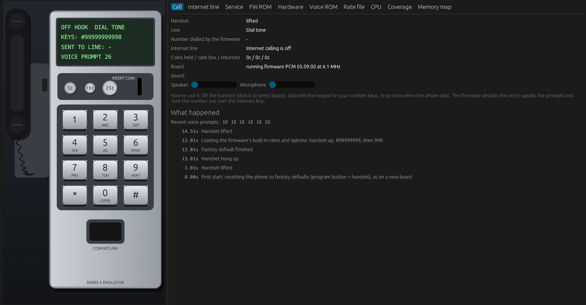
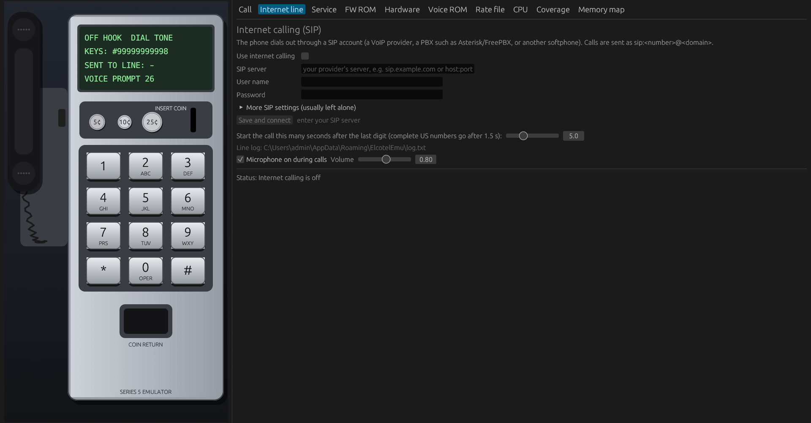
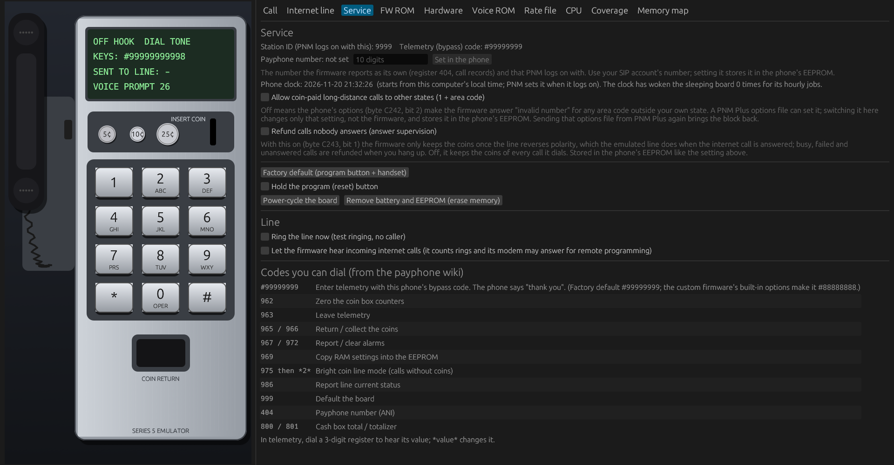
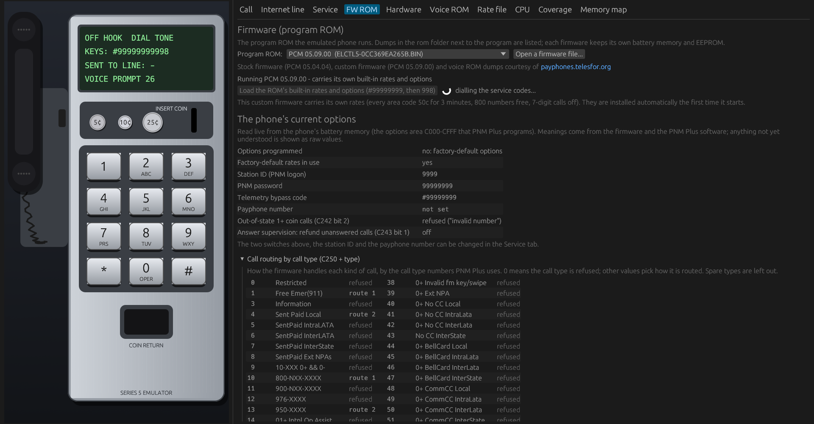
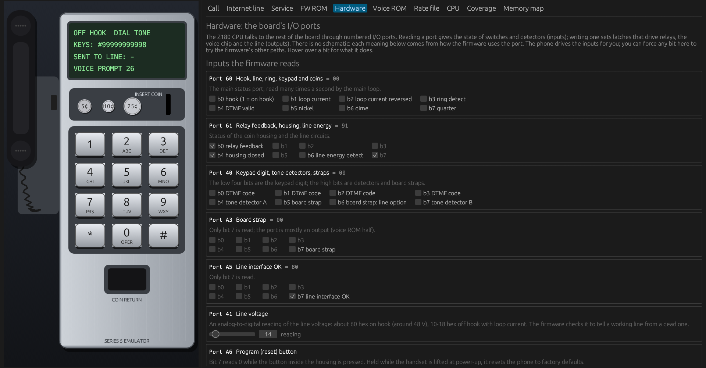
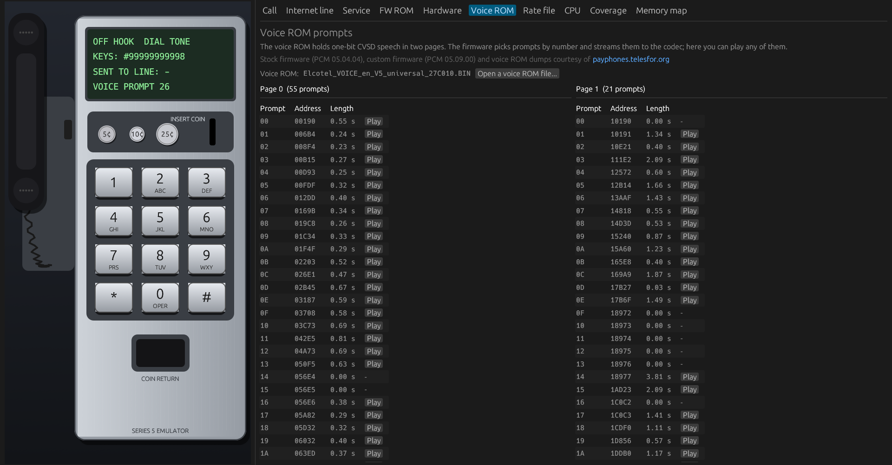
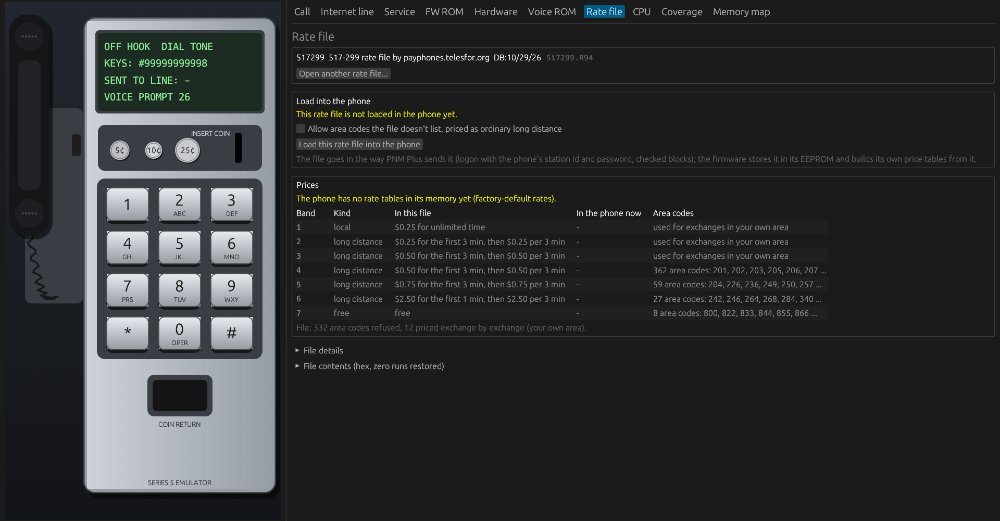
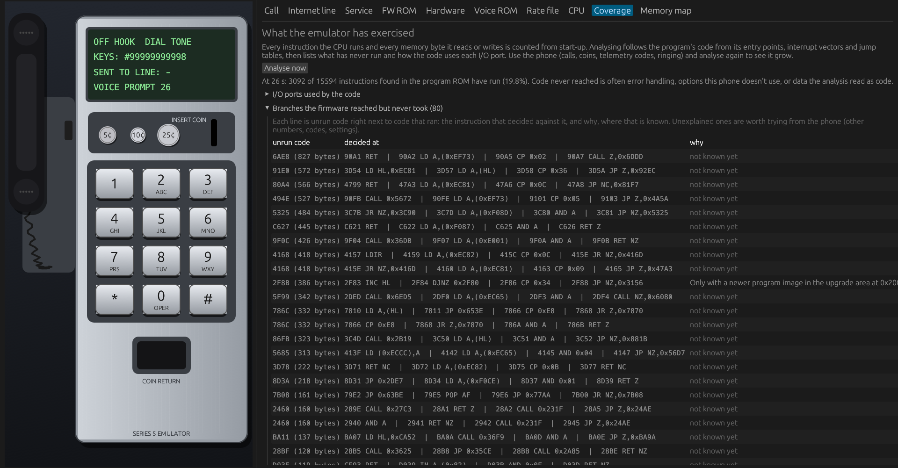
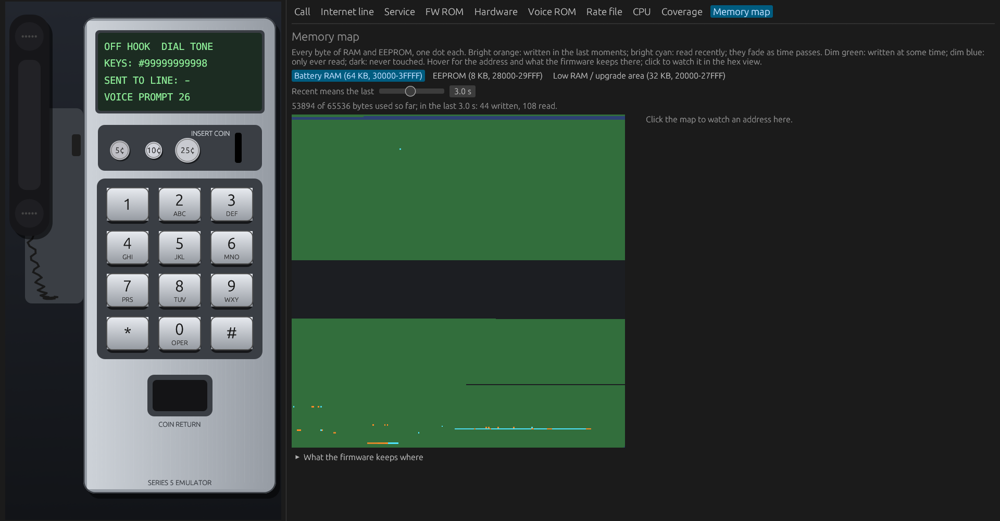

# Elcotel Series 5 payphone emulator

A desktop emulator for Elcotel Series 5 "smart" payphones that runs the
phone's real firmware. The program ROM executes instruction by instruction on
an emulated Zilog Z180 (HD64180), with the board around it: keypad, hook
switch, coin mechanism and relays, the MSM6242 real-time clock, the TDK 73K212
modem, the CVSD voice prompts, the battery-backed RAM and the EEPROM. The
phone line is a SIP account, so the payphone can make and take real calls,
and PNM Plus can dial in over it and program the phone through the emulated
modem.

This emulator was developed in parallel with **Elcotel Manager**, a rebuild of
the PNM Plus remote-management software. Each was used to check the other:
the manager's sessions (logon, password, rate and option downloads, reload,
hang up) were run against the firmware in this emulator, and what the
firmware accepted or refused showed what the protocol really is.

Written in Rust with [egui](https://github.com/emilk/egui). Windows is the
main target; nothing in the code is Windows-only except the time-zone lookup
for the phone's clock.



## Download

`bin/elcotel-emu.exe` is a ready-built Windows program (64-bit). Download
or clone the whole repository and run it: it finds the firmware, voice ROM
and rate file in the `rom/`, `voice/` and `rates/` folders beside `bin/`.

## Documentation

| | |
|---|---|
| This README | using it, building it, and the hooks for driving the phone from code |
| [docs/hardware.md](docs/hardware.md) | the board: memory map, options memory, every I/O port and bit, the other chips, the voice ROM format |
| [docs/testing.md](docs/testing.md) | unit tests, the scenario test modes, `--trace` scripts, and how much of the firmware has run |
| [docs/screenshots/](docs/screenshots) | every tab |

## Firmware, voice ROM and rate file

The dumps the emulator was built and tested with are included, courtesy of
[payphones.telesfor.org](https://payphones.telesfor.org):

| Folder | File | What |
|---|---|---|
| `rom/` | `Elcotel_PGM_5.4.4_1999_27C512.BIN` | stock firmware PCM 05.04.04 (64 KB, 27C512) |
| `rom/` | `ELCTL5-0CC369EA265B.BIN` | custom firmware PCM 05.09.00 with built-in rates |
| `voice/` | `Elcotel_VOICE_en_V5_universal_27C010.BIN` | English voice prompts (128 KB, 27C010) |
| `rates/` | `517299.R94` | PNM Plus rate file for the 517-299 exchange |

Each folder's README has the files' SHA-256 sums. To use other dumps, add
them to these folders (any file name) or open them from the FW ROM, Voice ROM
and Rate file tabs. The program looks for the folders next to itself, in the
folder above it, then in the working directory (so `cargo run` works from
the repository). The choice, the settings and each firmware's battery RAM and
EEPROM are kept in `%APPDATA%\ElcotelEmu`.

## Building

```
cargo build --release
```

The program is `target/release/elcotel-emu.exe`; run it from the repository
folder, or copy it next to the `rom/`, `voice/` and `rates/` folders. On the `x86_64-pc-windows-gnu` toolchain the
build needs GNU `dlltool` on the PATH (part of binutils); the MSVC toolchain
needs nothing extra. `cargo test` runs the unit tests (CPU, modem, clock, SIP
codecs, rate file; the rate file tests use the first `.R94` in `rates/`).

## The tabs

| Tab | What it shows |
|---|---|
| **Call** | the payphone: lift the handset (click it or press Space), dial with the keypad or the number keys, drop coins when the phone asks |
| **Internet line** | the SIP account the phone dials out on (your own server, user name and password); incoming calls ring the phone |
| **Service** | the phone's number, station id, telemetry code and clock, factory default, the program button, out-of-state coin calls and refunding unanswered calls |
| **FW ROM** | choose the program ROM, load a ROM's built-in rates, and see the phone's current options and call routing |
| **Hardware** | every input bit the firmware reads (each can be forced) and every output latch it drives, with what each port is |
| **Voice ROM** | choose the voice ROM and play any prompt |
| **Rate file** | the prices the phone is using now, read back from its memory, and loading a rate file the way PNM Plus does |
| **CPU**, **Coverage**, **Memory map** | debugger view, which code and I/O the firmware has run, and a live map of RAM and EEPROM accesses |

| | |
|---|---|
|  |  |
|  |  |
|  |  |
|  |  |

## How it fits together

```
app.rs      the window (egui)          ─┐
phone.rs    Phone: the person's actions, │  person-facing hooks
            the line, coins, SIP glue  ─┘
machine.rs  Machine: CPU + board, power off / wake-up
board.rs    PayBoard: memory map, I/O ports, keypad, coins, ring, relays, events
z180.rs     Z180 on-chip parts (MMU, timers, DMA, serial)   cpu.rs  Z80 core
rtc.rs      MSM6242 clock   cvsd.rs  voice decoder   modem.rs / dpsk.rs  software modem
sip.rs      SIP user agent and RTP audio   audio.rs  speaker / microphone
pnm.rs      PNM Plus protocol (rate downloads, option stores)   ratefile.rs  .R94 files
coverage.rs code / I/O coverage   disasm.rs  disassembler   files.rs  remembered choices
```

`Phone` runs on its own thread (`phone::spawn_runner`) and keeps the CPU in
step with real time; the window only locks it to read state and call the
hooks below.

### Memory map (physical addresses, after the firmware sets up the MMU)

| Range | What |
|---|---|
| 00000-0FFFF | program ROM (27C512) |
| 10000-1FFFF | voice ROM window; port A3 bit 0 picks which 64 KB half |
| 20000-27FFF | low RAM / upgrade area |
| 28000-29FFF | EEPROM (writes only while port A4 bit 0 is set) |
| 30000-3FFFF | battery-backed RAM; the firmware sees it at logical B000-DFFF and E000-FFFF |

Options PNM Plus programs live in battery RAM at logical C000-CFFF
(signature `RATES FOR PCM 5` at C000, telemetry bypass code at C0CC, station
id at C0D5, PNM password at C0DB, payphone number at C0E6, option switches at
C240-C24F, call routing at C250 + call type, checksums at CFFE / BFFE).

## The hooks

These are the places to drive the emulated phone from code, or to look when
something the firmware does needs explaining. Each person-facing hook exists
twice: `PayBoard` (board.rs) changes the input bits the firmware reads, and
`Phone` (phone.rs) wraps it with what the rest of a real phone would do (the
line, tones, the coin tally, SIP). Call the `Phone` version from outside.

### Handset (hook switch)

`Phone::set_hook(on_hook: bool)` → `PayBoard::set_hook`

- Port **60 bit 0**: 1 = on hook, 0 = off hook.
- Port **41** (line voltage ADC): 0x60 (about 48 V) on hook, 0x14 (about 8 V)
  with loop current off hook.
- Port **60 bits 1-2** (loop current): while off hook, bit 1 shows current on
  the line. When the far end answers with a polarity reversal
  (`PayBoard::line_reversed`, set on the SIP answer) current shows on bit 2
  instead; that is answer supervision, used to refund unanswered calls when
  the option C243 bit 1 is on. When the far end hangs up
  (`PayBoard::loop_open`) neither bit is set, and the firmware settles the
  coins and drops the call. Going back on hook clears both.
- Lifting the handset wakes a sleeping board (see Power), answers a ringing
  incoming call, and gives dial tone. Hanging up ends the SIP call.

### Keypad

`Phone::press_key(c)` for a tap, or `Phone::key_hold(c) -> id` and
`Phone::key_release(id)` for a key held down (mouse and keyboard use these).
Keys are `0-9 * #` (and `A-D`).

- Port **40 bits 0-3**: the DTMF receiver's code (1-9 = digits, 0x0A = 0,
  0x0B = `*`, 0x0C = `#`, 0x0D-0x0F, 0x00 = A-D); see `board::dtmf_code`.
- Port **60 bit 4**: the receiver's "digit valid" line, high while a key is
  down.
- A tap lasts 90 ms, a held key at least 70 ms; then a 70 ms gap, so the
  firmware sees separate digits. Presses queue, and none reaches the board in
  the first 1.2 s after it wakes up (the firmware is still booting).

### Coins

`Phone::drop_coin(which)` with 0 = nickel, 1 = dime, 2 = quarter.

- Port **60 bits 5 / 6 / 7** (nickel / dime / quarter): a 40 ms pulse per
  coin from the coin validator, then at least 800 ms before the next one (the
  firmware misses faster coins). Coins queue.
- The firmware settles coins with the coin relay on port **A1**: a rising
  edge on bit 3 pulses the relay, bit 2 says which way (1 = collect into the
  cash box, 0 = refund to the coin return). That raises
  `Event::CoinRelay(collect)`, and `Phone` moves the coins in escrow to the
  cash box or the coin return. A collect while the call is still up means the
  paid time ran out: `Phone` ends the SIP call too.

### Ringing (incoming calls)

`PayBoard::ring_signal = true` (set by `Phone` on an incoming SIP call).

- Port **60 bit 3**: ring detector, in a 2 s on / 4 s off cadence
  (`PayBoard::ring_now`; `ring_bit` and `ring_pulsed` say where and how it
  shows).
- Each ring burst wakes a sleeping board. Lifting the handset answers. If the
  firmware seizes the line itself while on hook (port A8 bit 0), it is the
  modem answering for remote programming, and the call is handed to the
  software modem.

### Program button

`PayBoard::program_button` → port **A6 bit 7** (0 while pressed). Also wakes
the board. The Service tab presses it for you.

### Voice prompts

The firmware streams CVSD bytes from the voice ROM to port **40** by DMA
channel 1, paced by timer 1 (one byte per 32 TOUT edges); `PayBoard` decodes
them (`cvsd.rs`) into `voice_pcm`, which the audio thread plays to the
handset. Each prompt starts at the firmware's prompt routine, PC **0x63A3**,
with the prompt number in A: `PayBoard::on_step` raises `Event::Prompt(n)`.

### Dialing out and the line

- Port **A8 bit 0**: the line relay (off hook to the network). Changes raise
  `Event::LineSeized(on)`.
- The firmware dials with the 73K212 modem chip (ports **C1** address,
  **C2** data): it loads the tone register (3) with the DTMF code | 0x10, then
  turns the transmitter on in CR0 (bit 1). Each rising edge raises
  `Event::DtmfOut(c)`. `Phone` collects the digits, waits for the number to be
  complete (`dial_wait`), and places the SIP call; digits sent during a call
  go out as SIP DTMF.

### Power and the clock

The board switches itself off by reading port **B8** (`PayBoard::power_off`);
`Machine` then only runs the MSM6242 clock (ports **80-8F**) until something
wakes it: the handset lifted, a ring burst, the program button, or the clock's
slow pulse (that is how hourly jobs run on an idle phone, counted in
`Machine::rtc_wakes`). Waking resets the CPU, as power coming back does.

### Events

`PayBoard::events` collects `Event::Prompt`, `DtmfOut`, `LineSeized` and
`CoinRelay` while the CPU runs; `Phone::board_event` handles them. Watch them
in the Call tab's log, or with `--trace`.

### Other ports

Port 61 (relay feedback, upper housing switch bit 4, line energy bit 6),
40 bits 4-7 (tone detectors, board straps), A0 (audio routing), A2 and 63
(aux relays and latch), A3 (voice ROM half), A4 (EEPROM write enable),
A5 bit 7 (line interface ready), B0 (strobe), and the Z180's own serial and
timer registers. [docs/hardware.md](docs/hardware.md) and the Hardware tab
list every port with what is known about it.

## Command-line test modes

They print to the console and use the dumps in `rom/`, `voice/` and
`rates/`. `ELCOTEL_ROM=<file name or path>` picks a program ROM.

| Command | What it does |
|---|---|
| `--selftest` | a full paid call: dial, pay, and the firmware places it to a local SIP test peer |
| `--ratetest` | load the rate file over the modem, then place calls (`NUMS=`, `COINS=`, `CALLSECS=`, `PAYAT=`, `REVERSE_AT=`, `CALLLOG=1`, `OPEN=1`, `SETNUM=`, `OPTSET=`, `ALLOW_OOS=1`, `NVRAM=<file>`, `NOIMPORT=1`) |
| `--presettest` | a ROM with built-in rates installs them |
| `--telemtest` | enter telemetry with the phone's bypass code at different typing speeds (`CODE=`, `WAITS=`, `GAPS=`, `NVRAM=`) |
| `--incomingtest` | an incoming SIP call rings the phone and is answered |
| `--modemtest` | a modem dials in over SIP and logs on (`MODEM=300` or `1200`) |
| `--coverage [report.txt]` | runs a long list of scenarios plus every remote command byte and reports code, I/O and memory coverage (`NOPROBE=1` skips the command sweep) |
| `--dis <hex addr> <count>` | disassemble the program ROM |
| `--trace <secs> [actions]` | headless run printing I/O, events and watched PCs |

More in [docs/testing.md](docs/testing.md).

## ELCOMPILER: your own programs in BASIC

ELCOMPILER is a companion project, published separately: a compiler that
turns BASIC programs into a program ROM for this board, so the phone runs
your code instead of Elcotel's. It has statements for the handset, keypad,
coins, coin relay, voice prompts and dialing (`OFFHOOK`, `GETKEY`, `CREDIT`,
`COLLECT`, `SAY`, `DIAL`...).

Put the `.bin` it writes in `rom/` and pick it in the FW ROM tab (it shows as
`ELCOMPILER: <name>`); what the program `PRINT`s appears under **Program
output** in the Call tab.

## Remote programming with PNM Plus

Let the firmware hear incoming calls (Service tab), then dial the phone's SIP
number from PNM Plus (or Elcotel Manager) through a modem that reaches the SIP
account. The emulator's software modem (Bell 103 at 300 bit/s, Bell 212A /
V.22 at 1200 bit/s) carries the data to the firmware's modem chip. The
calling modem must use 8 data bits, no parity, 1 stop bit.

## How the hardware was worked out

There is no schematic. The memory map, the I/O ports and every bit's meaning
were inferred from how the firmware uses them, and checked against the PNM
Plus protocol and real PNM Plus and Elcotel Manager sessions. Some of it (the
board straps, the aux relays) may still be wrong. The Coverage tab and the
`--coverage` report show how much of the firmware has run and what each port
is; [docs/testing.md](docs/testing.md) has the figures.

## Credits

The stock firmware (PCM 05.04.04), the custom firmware (PCM 05.09.00), the
voice ROM and the 517-299 rate file included in this repository come from
[payphones.telesfor.org](https://payphones.telesfor.org), and are included
with their attribution. The Elcotel firmware and voice recordings are
Elcotel's work; they are here for preservation and study of the hardware.
The emulator's own code doesn't contain or depend on them.
